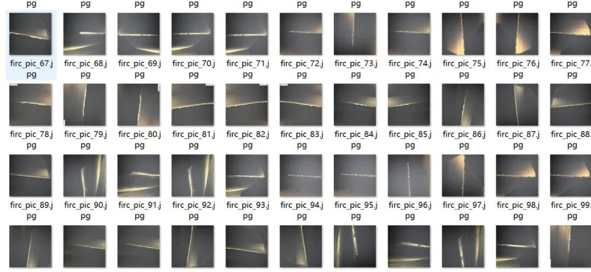
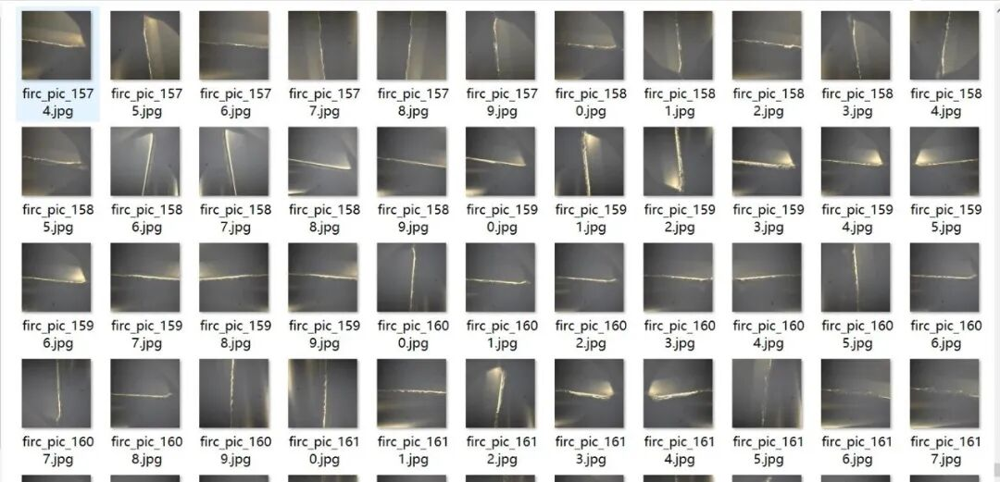
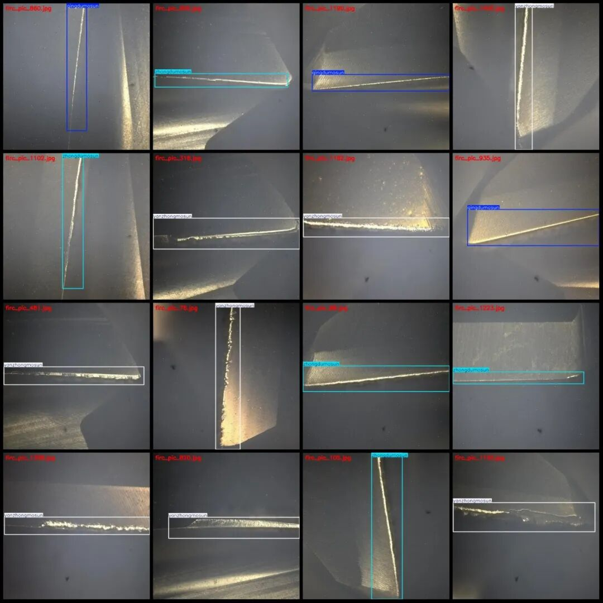
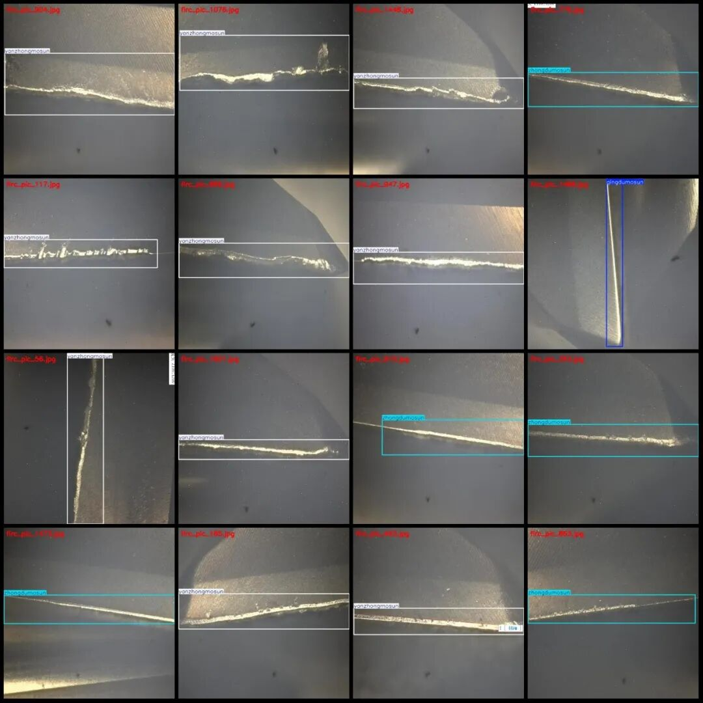

# Dataset of Surface Wear and Damage Detection for Tools in VOC+YOLO format with 1633 images in 4 categories

Please note that approximately 600 images in the dataset are originals, with the remaining being enhanced images. Please refer to the images for specific details.

Dataset format: Pascal VOC format + YOLO format (txt file without split path, only containing jpg images and corresponding VOC format xml files and yolo format txt files)

Number of images (number of jpg files): 1633

Number of annotations (number of xml files): 1633

Number of annotations (number of txt files): 1633

Labeling category count: 4

Label category names (Note that the order of categories in the Yolo format does not correspond to this, but is based on the classes.txt file in the labels folder): ["qingdumosun", "qingweimosun", "yanzhongmosun", "zhongdumosun"]

Matched Chinese category: ["Mild Wear", "Light Wear", "Severe Wear", "Moderate Wear"]

Number of boxes labeled in each category:

qingdumosun frame count = 95

qingweimosun frame count = 58

Yanzhongmosun Frame Count = 1084

Zhongdumosun frame count = 416

Total frame count: 1653

Number of images per category:

Qingdumosun's possession of images = 94

Qingweimosun owns 58 images.

Yan Zhong Mosun's possession of images = 1074

Zhongdumosun's possession of images = 407

Image resolution: 640x640

Using labelImg:

Annotation rules: Draw a rectangle around the category.

Important Notice: The dataset does not have separate training, validation, and test sets; you need to partition them yourself.

Special : This dataset does not guarantee the accuracy of the trained models or weight files.

Image Preview:

Annotation example:

## Payment

Here is a pay link on Stripe ( https://buy.stripe.com/3cs8yP7sY87d0vu9AB ). Please contact me lonlonago@foxmail.com after funding $89, and I will send you a complete data files , thank you!

